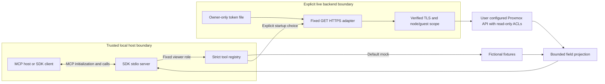

# Architecture and trust boundaries

The MCP transport is real local stdio; the demonstration backend is fictional.
The live adapter is implemented and tested with injected responses, without a
verified real-cluster deployment. No remote MCP endpoint or user authentication
service is included. The trusted host controls process launch and startup settings.

Tools accept only declared arguments. Fixed GET routes narrow behavior independently
of advisory MCP read-only annotations. Explicit upstream token ACLs are still needed.
TLS uses chain and hostname verification; cluster-specific insecure exceptions are
not included. Redirects are refused to keep tokens bound to the configured origin.

Field projection limits the fields returned. Real values can still contain
sensitive information. Review local output before sharing it. Backup recovery
requires a successful restore test.
